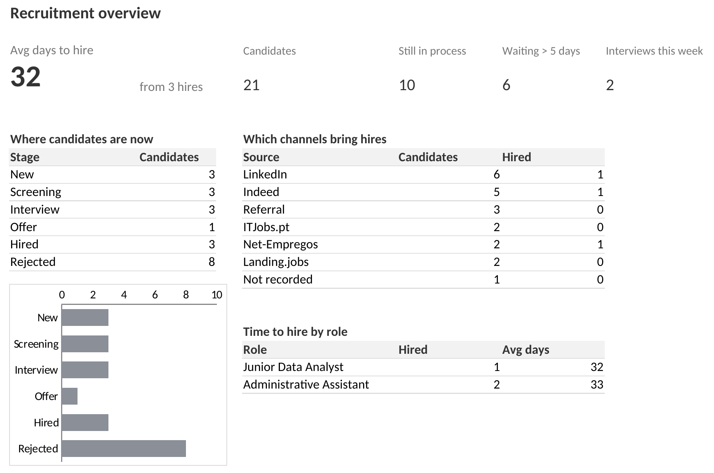
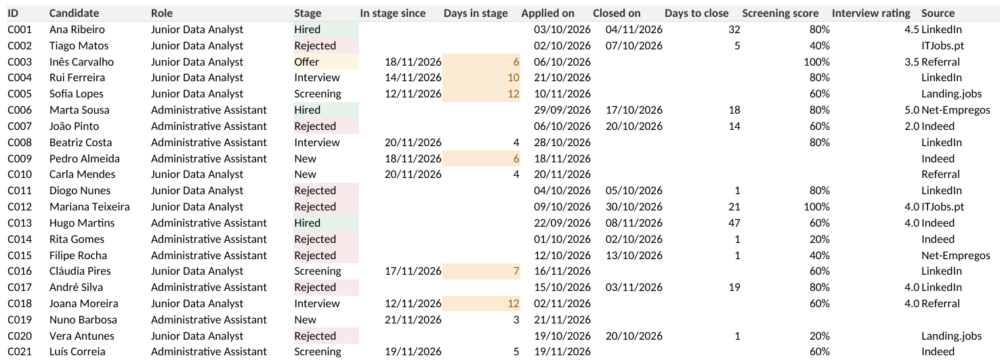

# mini-ats

I wanted to see if I could run a small hiring process from a spreadsheet: one list of candidates, a fair way to screen CVs, interview notes in one place, and a couple of numbers that tell me if hiring is slow and why. Paid ATS tools do this, but for a team hiring 2 or 3 people a year they are too much, so I built it in Excel.

The candidates are made up, but I tried to make the data messy like the real thing. Some people withdraw, one CV came by email with no source, one hire took 47 days because of a notice period.

## What's in the file

`mini-ats.xlsx` has a Candidates tab (the main list), a CV Screening tab, an Interviews tab, an Email Templates tab with invitation, rejection and offer emails in English and Portuguese, and the Dashboard.

The number I put at the top is average days to hire, because it is usually the first thing a hiring manager asks. Next to it is how many people have been sitting in the same stage for more than 5 days. In the Candidates tab those cells turn orange, so I can see who I need to call back.

## How it works

Every candidate gets an ID. In the other tabs I only type the ID and the name and role come from the Candidates tab. I used INDEX/MATCH instead of XLOOKUP because XLOOKUP doesn't work in Excel 2016, which a lot of companies still use.

Screening: each role has 5 requirements, and the first 3 are mandatory. I mark 1 or 0 for each. If any mandatory one is 0, the decision column says Reject, even if the score is high. I did it this way after seeing that a CV with 4 out of 5 could still be missing the one thing the role really needs (C016 has 60% but no English B2).

Days to hire only counts people who were hired, using AVERAGEIFS. "Days in stage" is today minus the date the stage last changed, so it updates every time you open the file.

## What the sample data shows

LinkedIn and Indeed bring most of the CVs (11 of 21), and each brought one hire. Referrals are only 3 people and one of them is already at offer stage, so with more data I would check if referrals convert better.

The 32-day average is pulled up by one hire with a 30-day notice period. Without him it is 25. With only 3 hires I wouldn't trust either number much yet.

## Things I'd change

Rejected and withdrew are in the same stage right now. They should be separate, because a candidate who withdraws says something about our process, not about the candidate.

Days are calendar days, not working days. NETWORKDAYS would fix it.

I'd like to load the CSVs from `data/` into SQLite next and check source vs. hire rate with SQL.

---

`scripts/build.py` is the Python I used to generate the sample data and the file. You don't need it to use the spreadsheet.
